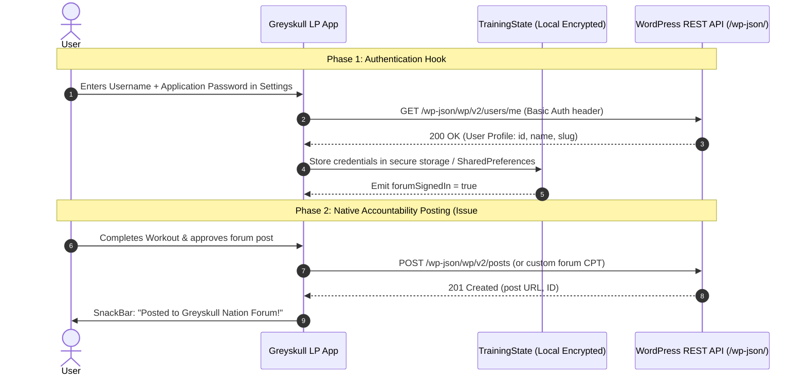

# Greyskull Nation Forum — WordPress Integration & Architecture

**Owner / Product Authority:** [@TheDevWhoSaysNi](https://github.com/TheDevWhoSaysNi)  
**Delivery Lead:** [@umerwaqas92](https://github.com/umerwaqas92)  
**Repository:** [suncoast-servers/GreyskullLP](https://github.com/suncoast-servers/GreyskullLP)  
**Related Issue:** Closes #19

---

## 1. Public Forum Stack & Discovery Analysis

An inspection of the live Greyskull Nation web infrastructure reveals:

- **CMS Core:** **WordPress** hosted via Cloudflare edge caching.
  - Active namespaces: `wp/v2` (standard REST API), `two-factor`, `wpaas/v1`, `coblocks`.
  - REST Discovery URL: `https://greyskullnation.com/wp-json/`
- **Forum Portal Routing:**
  - The live community forum is hosted directly at `https://forum.greyskullnation.com/` (also accessible via `https://greyskullnation.discussion.community/`). On the main WordPress site, `/forum` does not exist as an independent page (returns 404), so the app defaults directly to `https://forum.greyskullnation.com/`.
- **Authentication & Signup Endpoints:**
  - Standard WordPress Login: `https://greyskullnation.com/wp-login.php`
  - Member Registration: `https://greyskullnation.com/wp-login.php?action=register`
  - Lost Password: `https://greyskullnation.com/wp-login.php?action=lostpassword`

---

## 2. In-App Forum Experience (`lib/pages/forum_page.dart`)

Until official application credentials or OAuth/JWT API access are granted by the founder, the app delivers a **plug-and-play in-app browser experience**:

1. **Direct In-App Browsing:**
   - Powered by `webview_flutter` with JavaScript enabled and standard cookie persistence.
   - When a user logs in via the WebView or external browser, session cookies are preserved across sessions.
2. **Navigation Toolbar:**
   - Dedicated **Back** and **Forward** buttons so users can navigate deep discussion threads and return to the main board without losing context.
   - **Reload** button for fetching new replies.
   - **Open in Safari / Chrome** button for full external browser capabilities.
3. **Quick Jump Category Filters:**
   - **Main Boards:** Loads the primary forum board.
   - **Sign In / Account:** Jumps directly to the login portal.
   - **Training Logs:** Quick navigation to community training logs.
4. **Offline & Network Resilience:**
   - Detects connection drops and displays a helpful `_ForumOfflineErrorView` with retry and browser fallback options.

---

## 3. Future REST / Auth Architecture Roadmap

When Ryan obtains API credentials from Johnny Pain / Greyskull Nation, the app will transition to native REST integration.

### Proposed Authentication Pattern (WordPress Application Passwords / JWT)

### Supported Future Auth Methods:
1. **WordPress Application Passwords (Recommended):**
   - Built into WordPress 5.6+ core without needing external plugins.
   - User generates a single-purpose application password (e.g., "Greyskull App - iOS") in their WordPress user profile.
   - Eliminates need to store the user's master password on-device.
2. **JWT Authentication for WP REST API:**
   - Requires `jwt-authentication-for-wp-rest-api` plugin on the server.
   - App exchanges credentials for an expiring token and refresh token.

---

## 4. Settings & URL Flexibility

In [lib/pages/settings_page.dart](file:///Users/umerwaqas/Downloads/ryan_ellenburg/GreyskullLP/lib/pages/settings_page.dart), the forum integration provides:
- **Forum URL**: Default `https://forum.greyskullnation.com/`.
- **Forum Login URL**: Default `https://greyskullnation.com/wp-login.php`.
- **Reset to Defaults**: 1-tap restore to official defaults.
- **Display Name & Status**: Tracks whether the user is browsing as a guest or authenticated member.
