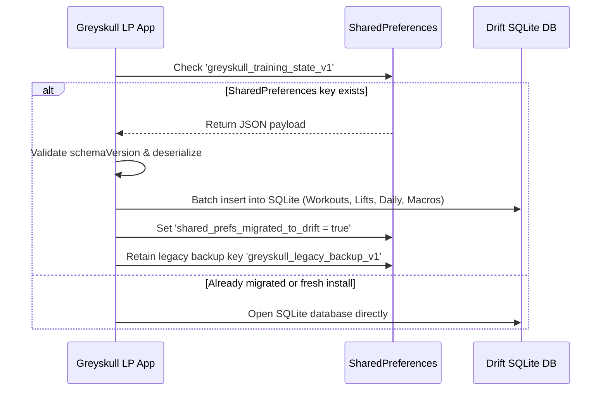

# ADR 0001: Local-First Open-Source Data Architecture & Optional Hetzner Cloud Sync

- **Status:** Accepted
- **Date:** 2026-11-11
- **Deciders:** Ryan (@TheDevWhoSaysNi), Umer (@umerwaqas92)
- **Consulted:** Johnny Pain / Greyskull Nation Community
- **Related Issues:** Closes #23, Informs #16, #21, #24

---

## 1. Context & Problem Statement

The official Greyskull LP mobile application is built to serve strength lifters worldwide under the authority of Johnny Pain and Suncoast Servers.

Currently, the application persists state as a single serialized JSON document stored in device local storage via `SharedPreferences` (`greyskull_training_state_v1`). While this approach is simple and completely decoupled from cloud dependencies, it exhibits several architectural limitations as the product matures:
1. **Query Scalability:** Computing multi-year volume analytics, AMRAP personal records, and lift progression curves across hundreds of workout sessions requires deserializing the entire document into memory.
2. **Relational Integrity:** Lifts, calisthenics entries, accessory custom templates, and bodyweight/nutrition logs lack foreign key constraints and atomic transaction guarantees.
3. **Multi-Device Parity:** Lifters training with an iPhone at the gym and reviewing statistics on an iPad or desktop currently have no synchronized view without manually transferring JSON exports.
4. **Market Landscape & Competitor Pitfalls:** Existing unofficial fitness applications frequently suffer from sloppy SQLite dump formats, opaque database locks, or force users into closed proprietary cloud silos with aggressive analytics tracking, subscription paywalls, and monetized health data harvesting.

We need a **local-first, open-source data architecture** that guarantees lifter data ownership, eliminates vendor lock-in, and provides an optional, cost-effective synchronization roadmap powered by Suncoast Servers' Hetzner infrastructure.

---

## 2. Decision Drivers

- **Local-First Guarantee:** 100% of app features (logging workouts, viewing history, timer, calisthenics ladders, nutrition tracking) must work without an internet connection in underground gym facilities.
- **Lifter Privacy & Trust:** "We do not steal or sell data." No mandatory user registration, no marketing analytics SDKs, and zero telemetry tracking.
- **Operational Cost Efficiency:** Server overhead for Suncoast Servers must be orders of magnitude cheaper than commercial BaaS (Firebase, Supabase, AWS DynamoDB).
- **Data Portability:** Lifters must always be able to export, inspect, and restore their raw training history in human-readable and standard database formats.
- **Smooth Migration:** Zero data loss for existing users currently running on `SharedPreferences` JSON storage.

---

## 3. Considered Architectural Options

| Option | Description | Offline Resilience | Data Privacy | Infra Cost (10k Users) | Implementation Complexity |
|---|---|:---:|:---:|:---:|:---:|
| **Option A: Status Quo (SharedPreferences JSON)** | Keep single JSON blob in local SharedPreferences | High (local) | High (local) | $0.00 / mo | Very Low |
| **Option B: Local SQLite (`drift`) + Optional Hetzner Sync** | Type-safe local SQLite as source of truth; optional sync to self-hosted Hetzner VPS | High (local-first) | High (E2EE / opt-in) | ~€3.79 – €13.40 / mo | Moderate |
| **Option C: Commercial Cloud BaaS (Firebase / Supabase)** | Cloud-hosted database with local caching SDK | Medium (cloud-first) | Low (central PII / telemetry) | $150 – $350+ / mo | Low-Moderate |
| **Option D: Pure Local SQLite (No Cloud Ever)** | Local SQLite only; manual file backup/restore | High (local) | High (local) | $0.00 / mo | Low |

---

## 4. Decision: Option B (Local-First SQLite via `drift` + Opt-In Hetzner Sync)

We select **Option B: Local-First SQLite (`drift`) with an optional self-hosted Hetzner sync service**.

### Core Architecture Principles:
1. **The Device is the Primary Source of Truth:**
   All reads and writes operate directly against the local on-device SQLite database. The user interface never blocks on network requests.
2. **Zero Cloud by Default:**
   Fresh installs operate entirely in `LocalOnly` mode without requiring an email, phone number, account creation, or internet connection.
3. **Optional Hetzner Cloud Sync (Suncoast Servers Hosted):**
   Lifters who desire seamless backup or multi-device sync between phone and tablet can opt-in to Ryan-hosted synchronization running on Suncoast Servers' Hetzner VPS infrastructure.

```mermaid
flowchart TD
    subgraph Client Device [Mobile Client (Flutter)]
        UI[Flutter UI / Pages] --> Repo[Training Repository]
        Repo --> Drift[Drift SQLite Database (Local Source of Truth)]
        Repo -.->|Optional Opt-In| SyncEngine[Background Sync Engine]
    end

    subgraph Export [User-Controlled Export]
        Drift --> JSONExp[JSON Backup File]
        Drift --> SQLExp[SQLite DB Export]
    end

    subgraph Hetzner [Suncoast Servers (Hetzner VPS)]
        SyncEngine -.->|Encrypted HTTPS Diff| SyncAPI[Go / PocketBase Sync API]
        SyncAPI --> HetznerDB[(Server Database / NVMe)]
    end
```

---

## 5. Cost & Order-of-Magnitude Analysis (Hetzner VPS)

### Data Sizing Assumptions:
- **Single Workout Entry:** ~1.2 KB (lifts, AMRAP notes, accessory volumes).
- **Daily Calisthenics & Nutrition Log:** ~0.6 KB.
- **Active Lifter Annual Footprint:**
  - 3 weight workouts/week × 52 weeks = 156 workouts × 1.2 KB ≈ 187 KB.
  - Daily frequency/ladder logs + nutrition = 365 × 0.6 KB ≈ 219 KB.
  - Annual data per active lifter ≈ **400 KB / year**.
- **5-Year Veteran Lifter:** ~2.0 MB total database size.

### Infrastructure Projection for 10,000 Active Users:
- **Total Storage Required:** 10,000 users × 2.0 MB = **20 GB** (easily fits on entry-level NVMe drives).
- **Daily Network Bandwidth:**
  - Each sync transmits incremental delta diffs (~3 KB to 8 KB per session).
  - 10,000 syncs / day × 8 KB = 80 MB / day = **2.4 GB / month**.

### Cost Comparison:

| Provider & Tier | Specifications | Monthly Cost | Annual Cost |
|---|---|---|---|
| **Hetzner Cloud CX22** *(Recommended)* | 2 vCPU, 4 GB RAM, 40 GB NVMe, 20 TB Traffic | **€3.79 / mo (~$4.15)** | **~$50 / yr** |
| **Hetzner Cloud CPX31** *(High Performance)* | 4 vCPU, 8 GB RAM, 160 GB NVMe, 20 TB Traffic | **€13.40 / mo (~$14.70)** | **~$176 / yr** |
| **AWS (AppSync + DynamoDB + Cognito)** | Managed cloud serverless stack for 10k users | ~$180.00 / mo | ~$2,160 / yr |
| **Firebase (Firestore + Auth + Cloud Functions)** | Google Cloud BaaS with continuous reads/writes | ~$240.00 / mo | ~$2,880 / yr |

> [!TIP]
> Hosting on a Hetzner CX22 virtual private server delivers a **>97% cost reduction** compared to commercial cloud providers while keeping total data control under Suncoast Servers.

---

## 6. Security & Authentication Architecture

When optional cloud sync is enabled, the authentication and encryption model is designed to preserve lifter privacy:

1. **Anonymous Device Keypair Authentication (Default Sync Mode):**
   - The client generates an Ed25519 public/private keypair on first sync enablement.
   - The public key serves as the account identifier; sync diffs are signed with the private key.
   - **No email, username, or personal credentials are required** to use cloud sync.
2. **Optional Passphrase-Based End-to-End Encryption (E2EE):**
   - Lifters can supply an optional master sync passphrase.
   - Data is encrypted client-side using **AES-GCM-256** derived via **Argon2id / PBKDF2**.
   - Suncoast Servers / Hetzner stores only encrypted ciphertext blobs—even in the event of server compromise, zero training logs or notes are readable.
3. **Transport Security:**
   - Strict TLS 1.3 with Cloudflare / Let's Encrypt certificates.
   - Rate limiting via nginx / reverse proxy to prevent denial-of-service abuse.

---

## 7. Migration Plan from SharedPreferences

To ensure existing lifters preserve their workout logs seamlessly:



1. **Pre-flight Check:** On application boot, inspect whether `SharedPreferences` contains `greyskull_training_state_v1`.
2. **Atomic Ingestion:** Parse the JSON payload and execute a batch transaction inserting records into Drift tables (`workouts`, `lifts`, `calisthenics_entries`, `diet_logs`, `accountability_drafts`).
3. **Safety Archive:** Rather than deleting the legacy string immediately, rename it to `greyskull_legacy_backup_v1` to ensure non-destructive rollback capability.
4. **Transparent Verification:** Run automated migration tests in CI verifying that a 500-workout historical JSON file migrates to SQLite with zero missing fields.

---

## 8. Backup & Export UX (Preventing Data Loss on Uninstall)

Mobile operating systems (iOS and Android) delete local sandbox files when an app is uninstalled. To prevent permanent loss of training records:

1. **Multi-Format Export:**
   - **JSON Export:** Human-readable, open schema for manual inspection, custom spreadsheets, or programmatic ingestion.
   - **SQLite Database File Export:** Raw `.sqlite` binary database for archival or direct opening in SQLite tools.
2. **Native Share Sheet Integration:**
   - Powered by `share_plus` to dispatch exports directly to **AirDrop, Google Drive, iCloud Files, Local Downloads, or Email**.
3. **1-Tap Clipboard Copy:**
   - Allows users to copy their complete backup string instantly for pasting into secure notes or password managers.
4. **Prominent Data Transparency Card:**
   - Clear disclosure in Settings informing users that their data is stored on-device and explaining how to export prior to changing devices.

---

## 9. Product & Marketing Angle

Suncoast Servers and Greyskull LP will prominently advertise this architecture as a core differentiator against corporate fitness apps:

> **Strength Without Surveillance.**  
> *The official Greyskull LP app is 100% local-first and open-source. Your workouts, lifts, body measurements, and nutrition belong to you—not our servers. No mandatory accounts, no advertising trackers, and no subscription paywalls. Your data stays on your phone, backed up on your terms.*

